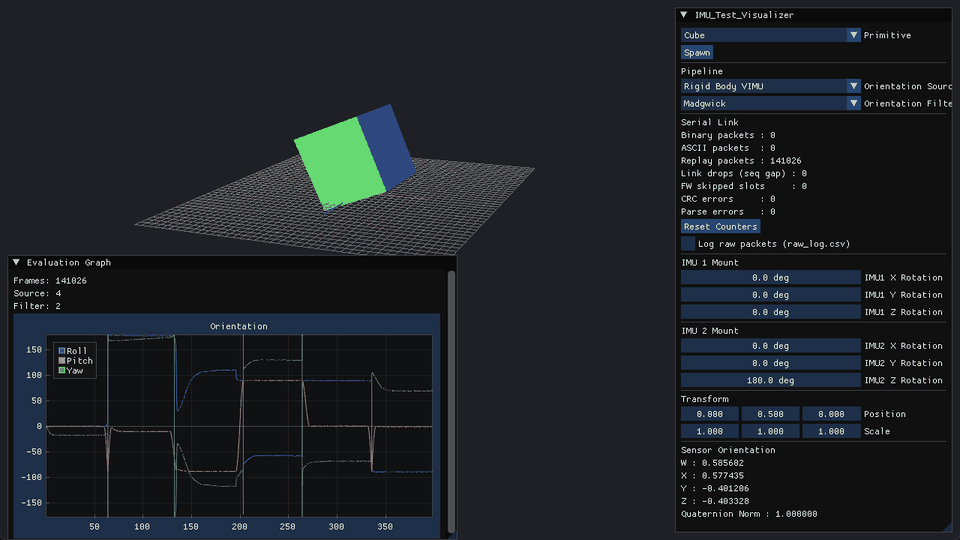
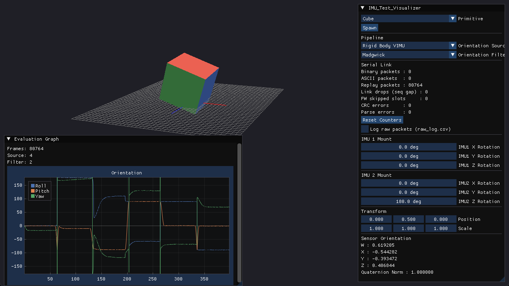
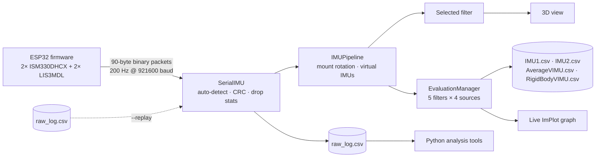
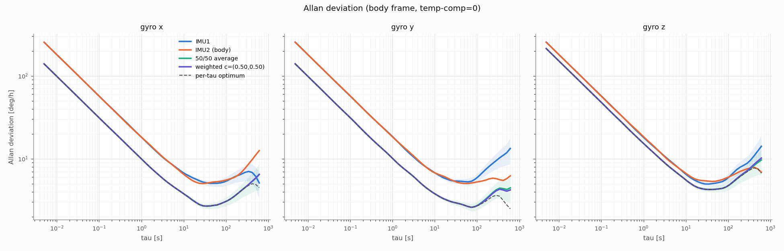
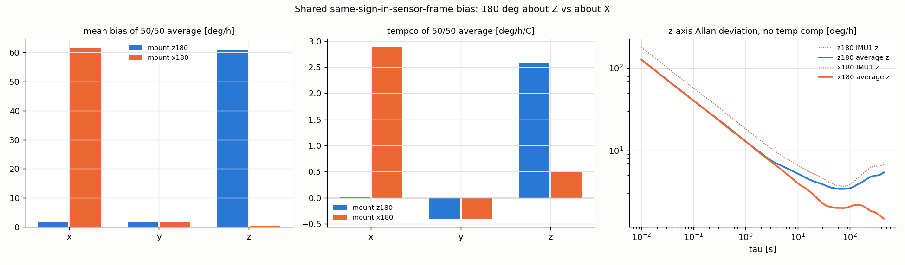
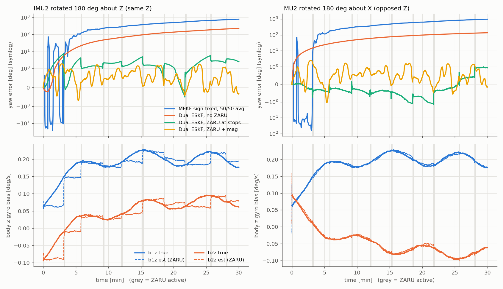

<div align="center">

# IMU-Visualizer

**Real-time 3D orientation tracking and filter comparison for a dual 9-axis IMU board**




<sub>Replaying a six-position sequence through the Rigid Body virtual IMU and the Madgwick filter. Faces are coloured by axis: <b>X</b> red, <b>Y</b> green, <b>Z</b> blue (darker shades for the negative faces).</sub>

</div>

---

An ESP32 streams two ISM330DHCX IMUs and two LIS3MDL magnetometers over serial at 200 Hz. The visualizer fuses them in five orientation filters, all written from scratch, and draws the result on a 3D model. It runs every filter on every input source at the same time and records the results, so you can compare them on the same data, both live and offline.

The repo also includes the ESP32 firmware, a set of Python tools for characterising the sensors (Allan deviation, thermal drift, six-position calibration), and a simulation study of a joint dual-IMU error-state Kalman filter.

## Highlights

| | |
|---|---|
| **5 orientation filters** | Accelerometer tilt, Complementary, Mahony, Madgwick and MEKF, with no external math libraries |
| **4 input sources** | IMU 1, IMU 2, an averaged *virtual IMU*, and a *rigid-body virtual IMU* that accounts for each sensor's mounting rotation |
| **Side-by-side evaluation** | Every filter runs on every source on each sample. Roll, pitch and yaw are plotted live and saved to CSV |
| **Robust serial link** | Binary 90-byte packets with a CRC-16, or ASCII lines, detected automatically. Counts sequence gaps, skipped firmware slots, CRC errors and parse errors |
| **Replay mode** | Play back any `raw_log.csv` recording in real time or faster. No hardware needed |
| **Analysis toolkit** | Python scripts for Allan deviation and covariance, temperature compensation, six-position calibration, and synthetic data with known ground truth |

<p align="center">
  
</p>

## Quick start

### 1. Build (Windows, MinGW-w64)

Requirements: MinGW-w64 (`g++`, `mingw32-make`), CMake, and a GPU that supports OpenGL 3.3. Dear ImGui, ImPlot and glad are vendored. SDL3 is a git submodule.

```bash
git clone --recursive https://github.com/rshz3028/IMU-Visualizer.git
cd IMU-Visualizer

# Build SDL3 once
cmake -S vendor/SDL -B vendor/SDL/build -G "MinGW Makefiles"
cmake --build vendor/SDL/build

mingw32-make          # -> build/imu_visualizer.exe (copies assets/ and SDL3.dll)
```

> [!TIP]
> The Makefile doesn't track header dependencies. After you change a header, run `mingw32-make clean` first. Otherwise stale object files can crash the app at runtime.

### 2. Try it without hardware

Generate a synthetic six-position recording and replay it at 4× speed:

```bash
python tools/make_synthetic.py --scenario six --out tools/out/synth/six.csv
cd build
./imu_visualizer.exe --replay ../tools/out/synth/six.csv --speed 4
```

In the control panel, click **Spawn** to add the cube, set **IMU2 Z Rotation** to `180` (the synthetic board's mount), then choose a source and a filter.

### 3. Run with the real board

Flash [`firmware/dual_imu_binary`](firmware/), plug in the ESP32, and set the port in `src/main.cpp`:

```cpp
static const char* IMU_SERIAL_PORT = "COM12";
static const int   IMU_BAUD_RATE   = 921600;
```

Every received packet is also written to `raw_log.csv`, which you can replay later or feed to the analysis tools.

## Controls

| Input | Action |
|---|---|
| Right mouse + drag | Look around |
| `W` `A` `S` `D` | Move |
| `Space` / `Ctrl` | Up / down |
| Numpad `1` / `3` / `7` | Front / right / top view |
| Double-click the graph | Fit the axes to all recorded data |

## How it works



### Filters

| Filter | Uses | Notes |
|---|---|---|
| Accelerometer | accel | Tilt from gravity only. No yaw, and noisy while the board moves |
| Complementary | accel + gyro | Gyro integration blended with accelerometer tilt |
| Mahony | accel + gyro + mag | PI correction of gyro drift on SO(3) |
| Madgwick | accel + gyro + mag | Gradient-descent orientation correction |
| MEKF | accel + gyro + mag | Multiplicative extended Kalman filter that also estimates gyro bias |

Each filter's source lives in [`src/filter/`](src/filter/).

### Serial protocol

The parser accepts both formats on the same port and detects which one is arriving.

**Binary (default firmware).** 90 bytes, little-endian:

```
[AA 55][seq u16][t_us u32][IMU1: a(3) g(3) m(3) T  f32×10][IMU2: same][CRC-16/CCITT-FALSE u16]
```

**ASCII (legacy).** One line per sample, with optional temperatures at the end:

```
R,<t_us>,<ax1>,<ay1>,<az1>,<gx1>,<gy1>,<gz1>,<mx1>,<my1>,<mz1>,<ax2>,...,<mz2>[,<temp1>,<temp2>]
```

Units are m/s², rad/s, µT and °C. The full packet spec, wiring, and I²C and bandwidth budgets are in [`firmware/README.md`](firmware/README.md).

## Sensor analysis tools

[`tools/`](tools/) holds Python scripts (numpy, scipy, pandas, matplotlib) for characterising the board from a `raw_log.csv`. All the plots below come from synthetic data with known ground truth, which [`run_validation.py`](tools/run_validation.py) uses to check each tool end to end.

<p align="center">
  
  <br><sub><b>Allan deviation</b> for each gyro axis. Averaging two IMUs lowers the noise floor, and the per-τ optimal weighting is shown as a dashed line.</sub>
</p>

<p align="center">
  
  <br><sub><b>Mounting matters.</b> A bias shared by both sensors cancels in the average only on the axes the mount rotation flips.</sub>
</p>

| Script | Purpose |
|---|---|
| `allan.py` | Overlapping Allan deviation and covariance, ARW / bias instability / RRW, optimal virtual-gyro weights |
| `thermal.py` | Linear and quadratic bias-vs-temperature fits, tempco comparison between IMUs |
| `six_position.py` | Accelerometer bias, scale and misalignment calibration |
| `make_synthetic.py` | Synthetic dual-IMU logs with every injected error saved to `.truth.json` |
| `imu_log.py` | Fast CSV and binary loaders with resync, timestamp unwrapping and gap detection |

See [`tools/README.md`](tools/README.md) for every option and the recommended experiments.

## Research: dual-IMU error-state Kalman filter

[`src/filter/dual_eskf_filter.cpp`](src/filter/dual_eskf_filter.cpp) implements one joint ESKF that tracks the attitude and the gyro biases of **both** IMUs. It uses the gyro difference `g1 − g2` as a pseudo-measurement, plus zero-rate updates (ZARU) whenever the board is stationary. It has been evaluated in a Monte-Carlo simulation ([`sim/`](sim/)) but is not yet selectable in the app.

<p align="center">
  
</p>

Results over 30 minutes at 200 Hz, 10 seeds, with IMU 2 rotated 180° about Z:

| Filter | RMS yaw error |
|---|---:|
| MEKF (sign-fixed reference in `sim/`), 50/50 averaged IMU | 592° ± 502° |
| Dual ESKF, no ZARU | 72° ± 56° |
| Dual ESKF, ZARU at stops | 1.5° ± 1.5° |
| **Dual ESKF, ZARU at stops + magnetometer yaw** | **0.81° ± 0.33°** |

The full table, including the 180°-about-X mount, is in [`sim/results_10seeds.txt`](sim/results_10seeds.txt).

## Project layout

```
src/              application: renderer, camera, scene, editor, serial, pipeline, evaluation
src/filter/       orientation filters
include/          headers
assets/           shaders and models
firmware/         ESP32 sketch (binary protocol) + packet self-test
tools/            Python analysis and synthetic-data tools
sim/              dual-ESKF Monte-Carlo simulation and results
docs/images/      README media
vendor/           SDL3 (submodule), glad, Dear ImGui, ImPlot
```

## Known limitations

- Windows only, because the serial backend uses the Win32 API.
- The serial port and baud rate are compile-time constants in `src/main.cpp`.
- The evaluation recorder keeps every sample in memory until the app exits, so very long sessions use a lot of RAM.

## License

MIT. See [LICENSE](LICENSE). Third-party code in `vendor/` keeps its own license.
